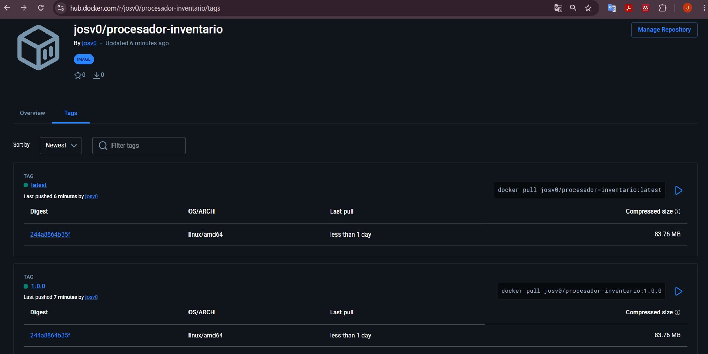

# Procesador de inventario de ferretería en Docker

Script de Python que **limpia el inventario de una ferretería**, calcula su **valor y márgenes**, y **detecta los productos que hay que reponer**. Está empaquetado en una imagen Docker publicada en Docker Hub.

- Imagen: [`TU_USUARIO/procesador-inventario`](https://hub.docker.com/r/TU_USUARIO/procesador-inventario)
- Etiquetas: `1.0.0` (versión estable) y `latest`

## Datos de ejemplo

`data/input/inventario_ferreteria.csv` contiene 62 filas de una ferretería **ficticia**, con 10 categorías: herramientas manuales y eléctricas, fijaciones, plomería, electricidad, pinturas, construcción, seguridad, cerrajería y jardinería. No incluye datos personales. Algunas filas tienen errores a propósito, para que se vea la limpieza.

| Columna | Descripción |
|---|---|
| `codigo` | Código del producto (ej. `HM-001`) |
| `producto` | Nombre del producto |
| `categoria` | Categoría |
| `marca` | Marca |
| `unidad` | Unidad de venta (unidad, caja, galón, saco…) |
| `stock` | Unidades disponibles |
| `stock_minimo` | Stock por debajo del cual hay que reponer |
| `costo_unitario` | Costo de compra en USD |
| `precio_venta` | Precio de venta en USD |
| `proveedor` | Empresa proveedora |
| `fecha_ultimo_ingreso` | Última fecha de ingreso de mercadería (AAAA-MM-DD) |

## ¿Qué hace?

1. Lee el CSV de entrada (ruta configurable).
2. Limpia los datos: quita espacios, unifica mayúsculas en las categorías y acepta la coma decimal (`1,05`).
3. Descarta filas duplicadas, con datos obligatorios vacíos, con códigos repetidos, con stock negativo o con precio de venta menor al costo.
4. Calcula `valor_inventario = stock × costo_unitario` y `margen_pct` para cada producto.
5. Clasifica cada producto como `OK`, `REPONER` (stock menor al mínimo) o `AGOTADO` (stock 0).
6. Escribe cuatro archivos de salida:

| Archivo | Contenido |
|---|---|
| `inventario_limpio.csv` | Productos válidos con valor, margen y estado |
| `resumen.csv` | Totales por grupo: productos, unidades, valor, margen promedio y productos por reponer |
| `reposicion.csv` | Lista de compras: productos agotados o bajo el mínimo, con cantidad sugerida |
| `reporte.json` | Métricas generales y motivos de descarte |

## Estructura del repositorio

```
.
├── procesar.py                            # Script de procesamiento
├── requirements.txt                       # Dependencias con versiones fijas
├── Dockerfile
├── .dockerignore
├── data/input/inventario_ferreteria.csv   # Datos de ejemplo
└── evidencias/                            # Captura de la publicación en Docker Hub
```

## Requisitos

Solo **Docker** (20.10 o superior). No hace falta instalar Python.

## Opción A: ejecutar la imagen publicada

```bash
git clone https://github.com/TU_USUARIO/procesador-inventario.git
cd procesador-inventario
mkdir -p data/output

docker run --rm \
  -v "$(pwd)/data/input:/data/input:ro" \
  -v "$(pwd)/data/output:/data/output" \
  TU_USUARIO/procesador-inventario:1.0.0
```

En **Windows PowerShell** escribe el comando en una sola línea y usa `${PWD}` en lugar de `$(pwd)`:

```powershell
docker run --rm -v "${PWD}/data/input:/data/input:ro" -v "${PWD}/data/output:/data/output" TU_USUARIO/procesador-inventario:1.0.0
```

## Opción B: construir la imagen localmente

```bash
docker build -t procesador-inventario:1.0.0 .
mkdir -p data/output
docker run --rm \
  -v "$(pwd)/data/input:/data/input:ro" \
  -v "$(pwd)/data/output:/data/output" \
  procesador-inventario:1.0.0
```

> **Linux:** el contenedor corre con el usuario sin privilegios `app` (UID 10001). Si aparece *Permission denied* al escribir la salida, agrega `--user "$(id -u):$(id -g)"` al `docker run`. En Docker Desktop (Windows y Mac) no hace falta.

## Variables de entorno

| Variable | Descripción | Valor por defecto |
|---|---|---|
| `INPUT_FILE` | Ruta del CSV de entrada dentro del contenedor | `/data/input/inventario_ferreteria.csv` |
| `OUTPUT_DIR` | Carpeta donde se escriben los resultados | `/data/output` |
| `GROUP_BY` | Agrupación del resumen: `categoria`, `proveedor` o `marca` | `categoria` |
| `LOG_LEVEL` | Nivel de detalle de los logs (`DEBUG`, `INFO`, `WARNING`) | `INFO` |

Ejemplo agrupando por proveedor:

```bash
docker run --rm -e GROUP_BY=proveedor \
  -v "$(pwd)/data/input:/data/input:ro" \
  -v "$(pwd)/data/output:/data/output" \
  TU_USUARIO/procesador-inventario:1.0.0
```

La imagen no contiene secretos ni datos: todo se pasa al ejecutar el contenedor.

## Volúmenes

| Ruta en el contenedor | Uso | Modo recomendado |
|---|---|---|
| `/data/input` | Carpeta con el CSV de entrada | solo lectura (`:ro`) |
| `/data/output` | Carpeta donde se escriben los resultados | lectura y escritura |

## Puertos

No aplica. Es un proceso por lotes (batch): se ejecuta, escribe sus archivos y termina, sin exponer puertos.

## Ejemplo con salida esperada

Con los valores por defecto, la consola muestra:

```
INFO Leyendo /data/input/inventario_ferreteria.csv
WARNING 1 producto(s) con fecha inválida: se conservan con fecha vacía
INFO Filas leídas: 62 | productos válidos: 57 | descartadas: 5
INFO   descartadas por duplicado: 1
INFO   descartadas por dato obligatorio vacío o no numérico: 2
INFO   descartadas por stock negativo: 1
INFO   descartadas por precio menor al costo: 1
INFO Resumen por categoria:
              categoria  productos  unidades  valor_inventario  margen_prom_pct  por_reponer
  Herramientas manuales          9       622            4355.1            24.88            2
               Pinturas          7       206           2744.68            25.59            1
               Plomería          7       528           2501.07            26.44            1
Herramientas eléctricas          6       164            2175.9            24.47            2
             Cerrajería          3       168            1900.1            24.83            0
             Jardinería          3       122            1225.4            24.73            1
           Electricidad          6       278            759.95            25.42            2
              Seguridad          4       133             704.8            26.38            1
           Construcción          5       174            632.92             25.9            1
             Fijaciones          7       280            261.77            25.31            3
INFO Valor total del inventario: $17261.69 | agotados: 4 | por reponer: 10
INFO Archivos escritos en /data/output
```

`data/output/reporte.json`:

```json
{
  "generado_utc": "2026-11-21T16:30:50+00:00",
  "archivo_entrada": "/data/input/inventario_ferreteria.csv",
  "agrupado_por": "categoria",
  "filas_leidas": 62,
  "productos_validos": 57,
  "filas_descartadas": {
    "duplicado": 1,
    "dato obligatorio vacío o no numérico": 2,
    "stock negativo": 1,
    "precio menor al costo": 1
  },
  "unidades_en_stock": 2675,
  "valor_total_inventario": 17261.69,
  "margen_promedio_pct": 25.4,
  "productos_agotados": 4,
  "productos_por_reponer": 10
}
```

`data/output/reposicion.csv` (primeras filas):

```csv
codigo,producto,categoria,proveedor,stock,stock_minimo,cantidad_sugerida,estado
CO-001,Cemento Portland 50 kg,Construcción,Materiales del Litoral S.A.,7,15,23,REPONER
EL-003,Tomacorriente doble,Electricidad,Electro Mayorista S.A.,10,25,40,REPONER
EL-005,Foco LED 9 W,Electricidad,Electro Mayorista S.A.,0,10,20,AGOTADO
```

`generado_utc` cambia en cada ejecución; los demás valores deben coincidir.

## Buenas prácticas aplicadas en el Dockerfile

- Imagen base **slim con versión fija**: `python:3.12.8-slim-bookworm`.
- `requirements.txt` se copia e instala **antes** del código, así la capa de dependencias queda en caché.
- Dependencias con **versiones fijas**.
- El contenedor corre con un **usuario sin privilegios** (`USER app`).
- `CMD` en **forma exec**: `["python", "procesar.py"]`.
- `.dockerignore` excluye `.git`, los entornos virtuales, `.env` y los datos.

## Publicación en Docker Hub

```bash
docker login
docker build -t TU_USUARIO/procesador-inventario:1.0.0 .
docker tag TU_USUARIO/procesador-inventario:1.0.0 TU_USUARIO/procesador-inventario:latest
docker push TU_USUARIO/procesador-inventario:1.0.0
docker push TU_USUARIO/procesador-inventario:latest
```

### Prueba de aceptación (desde el registro)

```bash
docker rmi TU_USUARIO/procesador-inventario:1.0.0 TU_USUARIO/procesador-inventario:latest
docker run --rm \
  -v "$(pwd)/data/input:/data/input:ro" \
  -v "$(pwd)/data/output:/data/output" \
  TU_USUARIO/procesador-inventario:1.0.0
```

Docker vuelve a descargar la imagen desde Docker Hub y produce la misma salida.

### Evidencia

- Enlace: https://hub.docker.com/r/TU_USUARIO/procesador-inventario/tags
- Captura: 

## Ejecutar sin Docker (opcional)

```bash
python -m venv .venv && source .venv/bin/activate
pip install -r requirements.txt
python procesar.py --input data/input/inventario_ferreteria.csv --output-dir data/output
```
